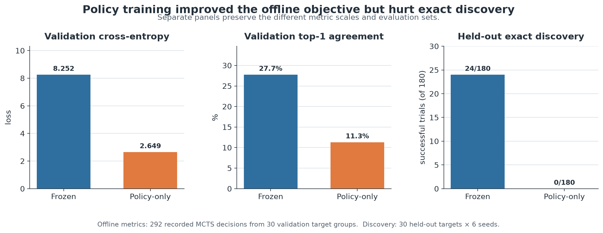
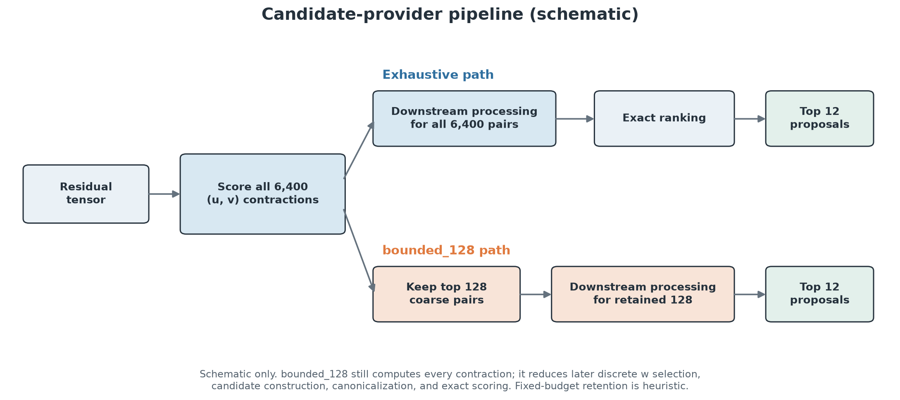
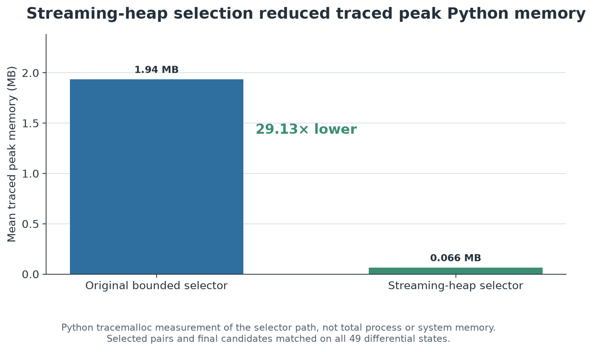
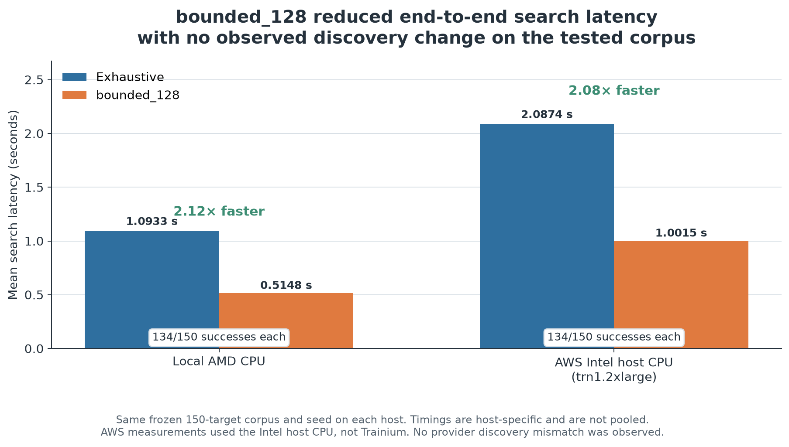

# When Better Training Made Search Worse: Optimizing Tensor Game Discovery in Matmul Inspector

*How a failed neural policy experiment led to a simpler, faster search strategy—and a 2.1× end-to-end speedup.*

## The Problem: Searching for Better Matrix Multiplication Algorithms

Matrix multiplication is one of the most important operations in modern computing. It powers everything from scientific simulations to the neural networks behind large language models.

We typically think of matrix multiplication as a fixed sequence of arithmetic operations. But the same mathematical result can sometimes be computed using different algorithms with different numbers of scalar multiplications.

This creates an interesting optimization problem: **Can we search for alternative matrix multiplication algorithms automatically?**

One way to approach this is through the *Tensor Game*, a search problem inspired by [AlphaTensor's reinforcement-learning formulation](https://doi.org/10.1038/s41586-022-05172-4) for discovering matrix multiplication algorithms.

In this framework, matrix multiplication is represented as a tensor decomposition problem. The search algorithm attempts to construct a valid decomposition by selecting sequences of rank-one tensor updates.

Each action consists of three vectors, conventionally called $u$, $v$, and $w$, whose outer product contributes to the decomposition:

$$
T \approx \sum_{i=1}^{r} u_i \otimes v_i \otimes w_i
$$

The goal is to find a sequence that exactly reconstructs the target tensor, ideally using as few terms as possible.

I wanted to explore this problem as part of **Matmul Inspector**, my open-source project for investigating matrix multiplication performance, compiler output, and optimization techniques.

What started as an experiment in learned search policies eventually became an investigation into candidate coverage, search overhead, memory consumption, and reproducible benchmarking.

And one of the most useful findings came from something that didn't work.

## 1. The First Experiment: Training a Better Policy

My initial approach focused on improving how the search algorithm selected candidate actions.

I used Monte Carlo Tree Search (MCTS), which explores possible action sequences and uses a policy to help prioritize promising candidates.

The idea seemed straightforward: collect useful search experience, train a policy to imitate it, and use the improved policy to guide future searches.

One offline validation metric initially looked promising, but the other validation and search metrics did not.

| Metric | Frozen checkpoint | Policy-only checkpoint |
|---|---:|---:|
| Validation cross-entropy on recorded MCTS supports | 8.252 | 2.649 |
| Validation top-1 agreement | 27.7% | 11.3% |
| Held-out exact-discovery trials | 24/180 | 0/180 |

These rows come from two related but distinct evaluations. Cross-entropy and top-1 agreement were measured on the offline validation set. Exact discovery was measured later on 30 held-out target groups with six search seeds per target. The full [policy-regression report](https://github.com/Lonny154/Matmul-Inspector/blob/v0.3.0/docs/tensor_game_policy_regression.md) records the protocol, checkpoint comparison, and limitations.



*Figure 1. The policy-only checkpoint reduced validation cross-entropy, while top-1 agreement and held-out exact discovery both declined. The panels use separate scales because the offline metrics and discovery results came from distinct evaluations.*

But actual search performance collapsed.

**The trained policy achieved lower validation cross-entropy on the recorded MCTS supports while becoming worse at held-out exact discovery.** Top-1 agreement also fell, so the evidence does not support the broader claim that the policy became uniformly better at imitation.

That was the first major turning point.

A lower validation cross-entropy wasn't evidence that the overall system had improved. In this case, it obscured the regression in the metric that mattered most: successful discovery.

## 2. Investigating the Regression

Rather than continuing to tune the model, I investigated why a policy with lower loss could perform so poorly.

I compared the original frozen policy against the trained policy on states where successful actions were known.

The difference was striking.

The 24 discovery regressions were six seeded repeats of four distinct one-step targets. On those four initial states:

- The frozen policy included the exact one-step action in its top 12 candidates on all four states, which accounts for all 24 successful repeated trials.
- The trained policy omitted it on all four states and solved none of the 24 repeated trials.
- Several important actions had effectively disappeared from the trained policy's practical search space.

The exact action ranked 2, 2, 3, or 5 under the frozen decoder. It was outside a bounded 256-action audit under the trained checkpoint. Its canonical log probability fell by 5.64 to 8.56 nats. Because each target allowed one move, these omissions fully explain the observed failures without requiring a later search divergence. The audit did not exhaust the full action space, so it establishes a rank beyond 256 rather than complete absence.

This exposed an important distinction:

**A policy can assign more probability to common or well-represented actions while losing the rare actions necessary to complete a solution.**

MCTS can only explore the candidates made available to it. If the right action never enters the candidate set, allocating more search simulations does not necessarily solve the problem.

I had initially been treating this as a model-training problem.

The evidence suggested it was fundamentally a candidate-generation problem.

## 3. Testing the Candidate-Coverage Hypothesis

To test that theory, I built a residual-informed candidate provider.

Instead of relying primarily on a learned policy to predict an action, the provider evaluates potential rank-one updates against the tensor residual—the portion of the target that remains unexplained by the current decomposition.

For a residual tensor $R$, a candidate action can be represented as:

$$
R' = R - u \otimes v \otimes w
$$

The provider uses residual information to rank candidates according to how promising they appear for reducing the remaining problem.

This is not the same as proving an action is part of an optimal decomposition. It is a heuristic for prioritizing candidates.

But it gave us a way to test whether candidate quality, rather than search depth alone, was the limiting factor.

The result was clear for this small preregistered workload.

| Candidate strategy | Successful searches |
|---|---:|
| Frozen policy | 0/24 |
| Trained policy | 0/24 |
| Hybrid policy | 0/24 |
| Exhaustive residual provider | 24/24 |

These results came from eight reserved targets with three seeded trials each. The targets had constructed depths one and two. Constructed depth is a known upper bound, not a proof of minimum tensor rank. The [held-out evaluation report](https://github.com/Lonny154/Matmul-Inspector/blob/v0.3.0/docs/tensor_game_heldout_evaluation.md) records the frozen hashes, search budgets, timing, and all 96 provider-target-seed trials.

The exhaustive residual provider succeeded in every trial, while the learned-policy approaches failed under the tested conditions.

This did not mean neural policies were inherently unsuitable for the Tensor Game.

It meant the policies and training methods I tested were not preserving the candidate coverage needed by this particular search configuration.

The next challenge became clear.

**The residual-informed provider worked, but how much of its computation could be eliminated without sacrificing observed discovery performance?**

## 4. Bounding the Search

The exhaustive residual provider evaluated a large set of candidate vector pairs.

For the tested configuration, there were 6,400 possible $(u,v)$ combinations.

That provided broad coverage, but it also introduced significant candidate-generation overhead. The bounded method still computed all 6,400 contractions. It avoided discrete $w$ selection, action construction, canonicalization, and exact scoring outside the retained prefix.

I implemented a bounded alternative, `bounded_128`, that retained the 128 highest-ranked pairs for further candidate evaluation.

The idea was to reduce the amount of downstream work while keeping the strongest candidates.

An early candidate-provider benchmark showed:

| Provider | Candidate latency |
|---|---:|
| Exhaustive | 47.03 ms |
| `bounded_128` | 29.03 ms |

That was approximately a **1.62× candidate-generation speedup**.

In the 30-state validation study, both exhaustive and `bounded_128` covered 28 states and recovered the same 31 of 44 verified-positive cases. `bounded_128` did omit five non-positive candidates from the exhaustive top-12 lists across three states. Its mean top-12 overlap with exhaustive was 98.9%.

This is an important caveat. The bounded ranking is heuristic because discrete coefficient quantization can reorder pairs. Matching verified-positive coverage on this validation set is not a fixed-budget exactness guarantee. See the [bounded-ranking benchmark](https://github.com/Lonny154/Matmul-Inspector/blob/v0.3.0/docs/tensor_game_bounded_residual.md) for the protocol and full latency ranges.



*Figure 2. Candidate-provider schematic. Both paths compute all 6,400 contractions. `bounded_128` reduces later work by retaining 128 coarse pairs before discrete coefficient selection and exact candidate processing.*

The question was whether that tradeoff would affect successful end-to-end search.

We needed to benchmark the entire algorithm, not just the candidate provider.

## 5. Reducing Memory Without Changing Candidate Selection

I also investigated the memory overhead of storing and ranking candidate pairs.

The original bounded implementation retained score records for all 6,400 pairs before choosing the best 128.

But we didn't need to retain every pair.

A fixed-size heap could maintain only the current 128 best candidates as the scoring process advanced.

This changed the memory requirements of the selection process without changing the intended selection policy.

The implementation was validated against the original bounded selector for exact candidate identity, ordering, and score equivalence in the tested cases.

Python-traced peak memory changed from approximately:

| Implementation | Peak traced memory |
|---|---:|
| Original bounded selector | 1.94 MB |
| Streaming heap selector | 0.07 MB |

That was a **29.13× reduction in mean traced peak Python memory** for the measured selector path. The underlying unrounded measurements were approximately 1.94 MB and 0.066 MB.

The key distinction is that this is not a 29× reduction in total application or system memory.

It measures the specific candidate-selection implementation under the Python tracing methodology.

The optimized selector produced identical selected pairs, candidate identities, ordering, and integer scores on all 49 differential states in that study. The [streaming-heap report](https://github.com/Lonny154/Matmul-Inspector/blob/v0.3.0/docs/tensor_game_bounded_memory.md) also separates uninstrumented latency samples from `tracemalloc` measurements.



*Figure 3. The streaming heap reduced mean traced peak Python memory by 29.13× in the measured selector path. This is a `tracemalloc` result, not total process memory.*

## 6. End-to-End Benchmarking

At this point, the bounded residual provider was faster and the selection implementation used substantially less traced memory.

But I wanted to know whether the complete Tensor Game search benefited.

I tested the exhaustive and bounded providers on the same frozen set of 150 targets.

Each provider received equivalent search conditions.

The local host used an AMD CPU. The frozen corpus contained 150 independently generated targets, one search seed per target, and matched provider settings. The results were:

| Metric | Exhaustive | `bounded_128` |
|---|---:|---:|
| Mean search latency | 1.0933 s | 0.5148 s |
| Successful discoveries | 134/150 | 134/150 |

The bounded provider was approximately **2.12× faster end to end**, with no observed difference in successful discoveries across the frozen target set. The [local rollout-decision report](https://github.com/Lonny154/Matmul-Inspector/blob/v0.3.0/docs/tensor_game_rollout_decision.md) includes the target composition, timing distribution, paired outcomes, and frozen protocol hashes.

To determine whether the improvement depended on my local machine, I repeated the evaluation using an AWS `trn1.2xlarge` instance.

Importantly, this benchmark executed on the instance's **Intel host CPU**, not the AWS Trainium accelerator.

| Metric | Exhaustive | `bounded_128` |
|---|---:|---:|
| Mean search latency | 2.0874 s | 1.0015 s |
| Successful discoveries | 134/150 | 134/150 |

That produced a **2.08× end-to-end speedup**. Eight exhaustive AWS trials reached the wall-time limit, but all eight were targets that both providers failed to solve. The [cross-machine report](https://github.com/Lonny154/Matmul-Inspector/blob/v0.3.0/docs/tensor_game_cross_machine_verification.md) documents the host metadata, integrity checks, and why timings were analyzed separately rather than pooled.

The matching direction and similar magnitude on the two CPUs reduce concern that the measured timing result was unique to one host. They do not establish performance on other processors or workloads. Replaying the same 150 targets on a second host also does not double the independent mathematical sample size.

However, zero observed differences does not prove the bounded provider is universally equivalent to exhaustive ranking. Different targets, search budgets, and workloads may reveal cases where omitted candidates matter.

The appropriate conclusion is narrower and more useful:

**On the tested 150-target workload, the bounded provider preserved observed discovery outcomes while reducing mean search latency by approximately half on both CPUs.**



*Figure 4. Mean end-to-end latency on the frozen 150-target workload. Both providers solved 134/150 targets on each host, with no observed discovery mismatch. Host timings are shown separately and were not pooled.*

## 7. Turning an Experiment Into a Usable Tool

A successful benchmark is useful, but I also wanted the optimization to be usable and reproducible outside my development environment.

I integrated the providers into the Matmul Inspector Tensor Game search interface.

Users can select between:

- `bounded_128`: the default, lower-overhead candidate provider.
- `exhaustive`: the explicit fallback for broader candidate evaluation and comparison.

I also added regression coverage, packaging checks, installed-command tests, and release automation.

The release candidate went through review, CI across Python 3.10–3.13, C++ compiler configurations, wheel and source-distribution validation, and clean-environment installation tests.

Matmul Inspector 0.3.0 is available from [PyPI](https://pypi.org/project/matmul-inspector/0.3.0/). The [v0.3.0 source tag](https://github.com/Lonny154/Matmul-Inspector/tree/v0.3.0) includes the Tensor Game command and evidence reports.

```bash
python -m pip install matmul-inspector==0.3.0
```

The release maintains an explicit exhaustive fallback, allowing users to choose between the optimized path and the broader search strategy rather than silently removing the original behavior.

## 8. What I Learned

This project changed how I think about optimization.

**First, optimizing a component-level metric can make the overall system worse.**

The trained policy achieved much lower validation cross-entropy on recorded MCTS supports, but exact discovery dropped from 24/180 to 0/180. Without end-to-end evaluation, I might have mistaken that metric improvement for system-level progress.

**Second, candidate coverage can matter more than additional search computation.**

The search algorithm cannot reliably recover actions that its candidate provider systematically excludes. Before spending more computation on MCTS, it was necessary to determine whether useful actions were available at all.

**Third, simpler algorithms can outperform more complicated approaches when they address the actual bottleneck.**

I experimented with several learned-policy architectures and training objectives. None produced the held-out improvement I was looking for.

The eventual speedup came from bounding a deterministic residual search and using a better data structure.

**Fourth, an optimization isn't finished when a microbenchmark gets faster.**

The candidate-generation speedup was encouraging, but the more meaningful evidence came from end-to-end search latency, discovery outcomes, cross-machine replication, and clean installation tests.

Finally, I learned the value of keeping unsuccessful experiments.

The negative results weren't wasted effort. They helped rule out explanations and directed the investigation toward the optimization that ultimately worked.

## 9. What's Next?

Matmul Inspector started as a way to investigate low-level matrix multiplication performance, including compiler artifacts such as PTX and SASS, as well as accelerator kernels.

The Tensor Game work added another dimension: algorithm discovery and search optimization.

A future direction is to connect these layers more closely—using reproducible experiments to understand not only whether a mathematically interesting algorithm can be discovered, but also how efficiently it can be implemented and executed on real hardware.

Another major goal is automating the experimental workflow: generating candidates, validating correctness, collecting performance measurements, recording failures, and comparing results across configurations.

The long-term vision is a tool that makes low-level optimization more systematic, measurable, and accessible.

## Reproducing the Figures

The figures are generated by [`scripts/generate_tensor_game_case_study_figures.py`](../../scripts/generate_tensor_game_case_study_figures.py). Run it from the repository root with Matplotlib installed:

```bash
python scripts/generate_tensor_game_case_study_figures.py
```

The generator validates and reads these machine-generated evidence files:

- `artifacts/tensor-game/tg4c-policy-regression-v1/analysis.json`
- `artifacts/tensor-game/tg4w-rollout-decision-v1/summary.json`
- `artifacts/tensor-game/tg4x-cross-machine-preparation-v1/aws-full/summary.json`
- `artifacts/tensor-game/tg4x-cross-machine-preparation-v1/cross-machine-comparison.json`
- `artifacts/tensor-game/tg4t-bounded-memory-v1/summary.json`

The `artifacts/` directory is intentionally ignored by Git. A clean checkout contains the rendered figures and tracked aggregate reports, but regenerating the figures requires restoring the archived evidence bundle at the paths above. The script fails if an input is missing or if key counts and comparison invariants do not match the recorded experiments.

## Project Links

- **GitHub:** https://github.com/Lonny154/Matmul-Inspector
- **Tensor Game source and reports (v0.3.0 tag):** https://github.com/Lonny154/Matmul-Inspector/tree/v0.3.0
- **PyPI 0.3.0:** https://pypi.org/project/matmul-inspector/0.3.0/
- **Local benchmark evidence:** [policy regression](https://github.com/Lonny154/Matmul-Inspector/blob/v0.3.0/docs/tensor_game_policy_regression.md), [held-out provider comparison](https://github.com/Lonny154/Matmul-Inspector/blob/v0.3.0/docs/tensor_game_heldout_evaluation.md), [bounded-provider microbenchmark](https://github.com/Lonny154/Matmul-Inspector/blob/v0.3.0/docs/tensor_game_bounded_residual.md), [memory benchmark](https://github.com/Lonny154/Matmul-Inspector/blob/v0.3.0/docs/tensor_game_bounded_memory.md), [150-target local benchmark](https://github.com/Lonny154/Matmul-Inspector/blob/v0.3.0/docs/tensor_game_rollout_decision.md), and [AWS CPU replay](https://github.com/Lonny154/Matmul-Inspector/blob/v0.3.0/docs/tensor_game_cross_machine_verification.md)

---

*All reported performance improvements refer to the specified experimental configurations. The Tensor Game search was evaluated on CPUs, and these results do not establish GPU or Trainium runtime speedups. Raw generated benchmark artifacts remain in the project's ignored local artifact directories. The linked repository reports provide aggregate results, protocols, hashes, and limitations, but a clean checkout does not contain every raw trial record.*
